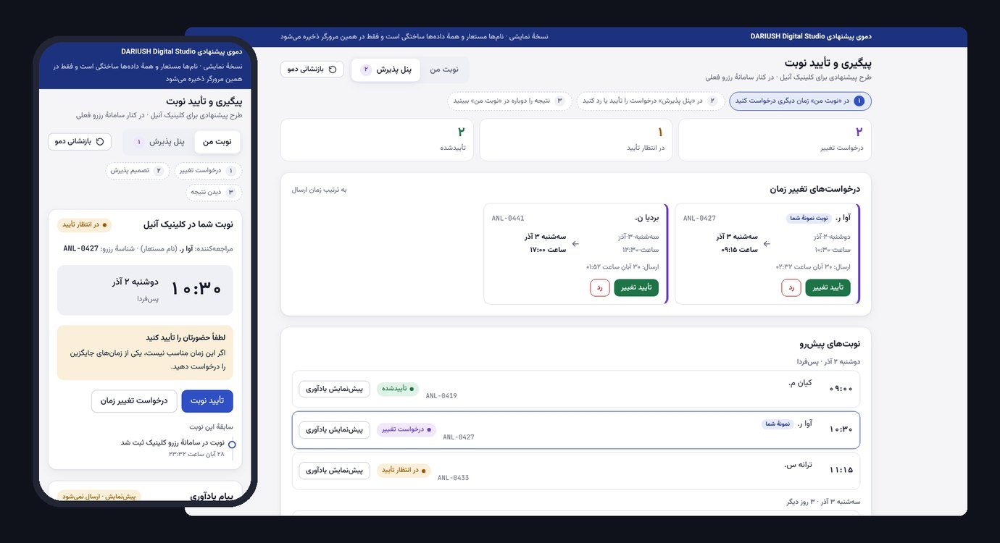

<div align="center">
  <h1>Clinic Appointment Follow-up Demo</h1>
  <p><b>A Persian, right-to-left web demo for confirming or rescheduling an appointment, with a reception panel and a reminder preview.</b></p>
  <p>Proposal demo by <b>DARIUSH Digital Studio</b> for <b>Anil Clinic</b> · pseudonyms and sample data only</p>
  <p>
    <a href="https://dariush-tech.github.io/anil-appointment-demo/"><b>Live demo</b></a> ·
    <a href="#demo-flow">Demo flow</a> ·
    <a href="#run-locally">Run locally</a>
  </p>
  <p>
    
    
    
    
    
  </p>
  
</div>

<div dir="rtl">

### خلاصه

دموی پیشنهادی DARIUSH Digital Studio برای کلینیک آنیل که کنار سامانهٔ رزرو فعلی کار می‌کند. مراجعه‌کننده در «نوبت من» تاریخ و ساعت نوبت را می‌بیند، آن را تأیید می‌کند یا یکی از زمان‌های جایگزین را درخواست می‌دهد. درخواست بلافاصله در «پنل پذیرش» ظاهر می‌شود، پذیرش آن را تأیید یا رد می‌کند و نتیجه در «نوبت من» به‌روز می‌شود. پیام یادآوری فقط پیش‌نمایش است و ارسال نمی‌شود. فقط نام مستعار، زمان و شناسهٔ رزرو نمونه به کار رفته است.

</div>

## Demo flow

1. **My appointment.** The visitor sees the date and time of a sample appointment (pseudonym *آوا ر.*, booking `ANL-0427`). They can confirm it, or pick one of three sample alternative times and send a change request.
2. **Reception panel.** The request appears at the top right away, showing the current and requested times side by side. Reception approves it, or rejects it with a reason from a short preset list.
3. **Result.** Back in *My appointment*, an approved change shows the new time; a rejected one shows the reason and keeps the original slot. Every step is added to the appointment's history.

A three-step guide under the header ticks off each step as the visitor completes it.

## Features

- **Reminder preview** with date, time, booking ID and a placeholder change link (`nobat.example/ANL-0427`), plus the four-step path a visitor follows to change the appointment from the message. Tapping the link in the preview opens the change flow.
- **Reception overview.** Counts of change requests, unconfirmed and confirmed appointments, and the upcoming appointments grouped by day, each with its own reminder preview.
- **Live sync.** State is saved in `localStorage`; a change made in one browser tab shows up in another tab through the `storage` event.
- **Reset.** The reset button restores the sample data after an in-page confirmation.
- **Persian calendar dates** through `Intl.DateTimeFormat("fa-IR-u-ca-persian")`, light and dark themes, phone layouts and keyboard-accessible controls.

## Privacy by design

- No intake form, medical history or treatment information is collected or shown.
- No doctor or service names; only a pseudonym, the time and a sample booking ID.
- Nothing is sent: reminders are previews, and all data stays in the visitor's own browser.

## Project structure

```
anil-appointment-demo/
├── index.html    # markup, styles and scripts (single file, no build step)
└── docs/         # README media
```

## Run locally

```bash
git clone https://github.com/dariush-tech/anil-appointment-demo.git
cd anil-appointment-demo
python3 -m http.server 8000
# open http://localhost:8000
```

---

Design & development: [Dariush Technology](https://github.com/dariush-tech) · DARIUSH Digital Studio
